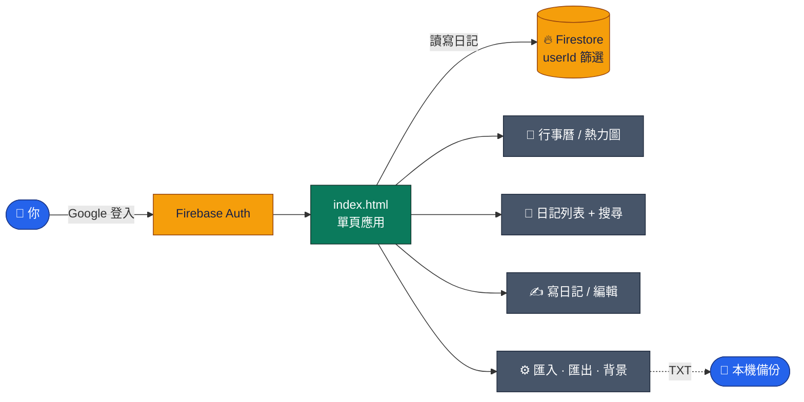

<a id="top"></a>

<div align="center">


<br>

[](https://github.com/Jiachang1112/Jiachang-diary)
[](https://github.com/Jiachang1112)
[](https://jiachang1112.github.io/Jiachang-diary/)

[](https://developer.mozilla.org/docs/Web/HTML)
[](https://developer.mozilla.org/docs/Web/CSS)
[](https://developer.mozilla.org/docs/Web/JavaScript)
[](https://firebase.google.com/)
[](https://firebase.google.com/docs/auth)
[](https://firebase.google.com/docs/firestore)
[](https://fontawesome.com/)
[](https://pages.github.com/)

**Google 登入的雲端日記 ‧ 行事曆與心情熱力圖 ‧ 標籤搜尋 ‧ 深色模式 ‧ 自訂背景 ‧ 匯入匯出備份**

<br>

[](#-特色)
[](#-快速開始)
[](#-firebase-設定)
[](#-注意事項)
[](#-常見問題)

</div>

---

## ✨ 特色

<table>
<tr>
<td width="33%" valign="top">

### 🔐 Google 登入
用 Google 帳號登入，日記存在雲端，不同裝置登入同一個帳號就能看到。

</td>
<td width="33%" valign="top">

### 📅 行事曆與熱力圖
月曆顯示哪幾天寫了日記，並以熱力圖呈現寫作頻率，點日期可看當天內容。

</td>
<td width="33%" valign="top">

### 😊 心情與標籤
每篇日記可選心情、加上標籤（半形逗號分隔），卡片上會顯示。

</td>
</tr>
<tr>
<td width="33%" valign="top">

### 🔍 全文搜尋
搜尋框可搜日記內容與標籤。

</td>
<td width="33%" valign="top">

### 🌙 深色／淺色
一鍵切換主題，並記住你的選擇；也可以自訂背景圖片網址。

</td>
<td width="33%" valign="top">

### 📦 匯入與匯出
支援文字批次匯入日記，也能把全部日記匯出成 TXT 備份。

</td>
</tr>
</table>

---

## 🧩 運作方式



### 📁 檔案說明

```text
Jiachang-diary/
├── index.html                單檔網頁：介面、樣式與全部邏輯
└── assets/readme/readme-banner.svg
```

---

## ⚡ 快速開始

**線上使用：** 開啟 [https://jiachang1112.github.io/Jiachang-diary/](https://jiachang1112.github.io/Jiachang-diary/)，用 Google 登入即可開始寫。

**本機使用：**

```bash
git clone https://github.com/Jiachang1112/Jiachang-diary.git
cd Jiachang-diary
python3 -m http.server 8000      # 打開 http://localhost:8000
```

> Firebase 的 Google 登入只允許「授權網域」。本機測試時，請到 Firebase Console 的 Authentication → 設定 → 授權網域，確認有 `localhost`。

---

## 🔥 Firebase 設定

1. 到 [Firebase Console](https://console.firebase.google.com/) 建立專案。
2. **Authentication → 登入方式** 啟用 **Google**，並在「授權網域」加入你的 GitHub Pages 網域（`jiachang1112.github.io`）。
3. 建立 **Firestore Database**。
4. 把專案的 Web 設定貼進 `index.html` 的 `firebaseConfig`。
5. 設定 Firestore 安全規則，讓每個人只能讀寫自己的日記（見下方）。

---

## ⚠️ 注意事項

- **一定要設定 Firestore 安全規則。** 網頁中的 Firebase 設定本來就是公開的，真正保護日記的是規則；沒有規則的話，任何人都可能讀到或改到資料。日記文件有 `userId` 欄位，規則範例：

```text
rules_version = '2';
service cloud.firestore {
  match /databases/{database}/documents {
    match /{document=**} {
      allow read, update, delete: if request.auth != null && resource.data.userId == request.auth.uid;
      allow create: if request.auth != null && request.resource.data.userId == request.auth.uid;
    }
  }
}
```

> 實際集合名稱請依你的 Firestore 資料結構調整，並用規則模擬器測試。
- 自訂背景網址與主題設定存在這台瀏覽器的 localStorage，換裝置不會同步。
- 匯出的 TXT 是純文字備份，建議定期下載保存。

---

## ❓ 常見問題

<details>
<summary><b>按下 Google 登入沒反應</b></summary>

確認瀏覽器沒有擋彈出視窗，且目前網域已加入 Firebase 的授權網域。

</details>

<details>
<summary><b>換手機看不到日記</b></summary>

請用同一個 Google 帳號登入，資料存在雲端。

</details>

<details>
<summary><b>匯入格式是什麼</b></summary>

到「設定 → 大量匯入日記」頁面，裡面有格式說明與輸入框，貼上文字後確認即可。

</details>

<details>
<summary><b>怎麼備份</b></summary>

到「設定 → 匯出與備份」按「匯出全部日記 (TXT)」。

</details>

---

<div align="center">

[GitHub @Jiachang1112](https://github.com/Jiachang1112)　‧　[Jiachang-diary](https://github.com/Jiachang1112/Jiachang-diary)

[](#top)

</div>
